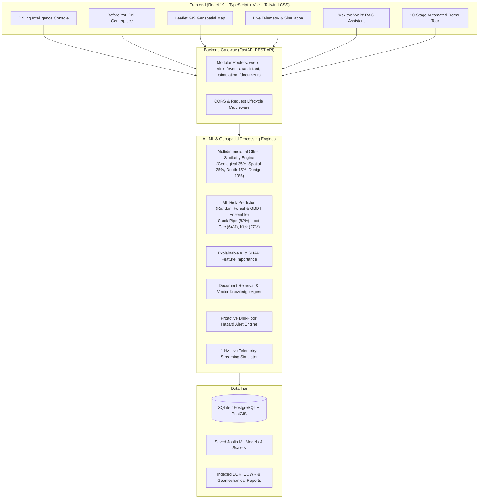

# eRTMAC-NWIS — Nearby Wells Intelligence System
### *“Learn from every well before drilling the next one.”*

[](https://fastapi.tiangolo.com)
[](https://react.dev)
[](https://www.typescriptlang.org/)
[](https://scikit-learn.org/)
[](https://tailwindcss.com)
[](https://opensource.org/licenses/MIT)

**eRTMAC-NWIS** is an enterprise AI decision-support platform designed for **Oil & Gas drilling operations**. It empowers drilling engineers, geoscientists, and operations teams to analyze planned and active drilling wells against historical, geologically correlated offset wells in real time.

---

## 🏛️ 1. Architecture Overview



---

## 🚀 2. Key Features

### 1. 🎯 "Before You Drill" Flagship Centerpiece
- Delivers complete situational awareness in **under 10 seconds**.
- Displays current measured depth (`2,715 m MD`), active target formation (`Fatehgarh Lower`), historical offset analogues, predicted risk bars, and immediate pre-drill mitigation checklists (wiper trips, mud lubricity dosing, survey dwell limits).

### 2. 🧭 Multidimensional Offset Similarity Engine
- Evaluates offset wells beyond simple Euclidean distance using a 6-factor composite formula:
  - **Geological & Lithological Similarity (35%)**
  - **Spatial Proximity Decay (25%)**
  - **Depth Interval Correlation (15%)**
  - **Formation Boundary Match (10%)**
  - **Drilling Trajectory & Well Type Design (10%)**
  - **Historical Incident Performance (5%)**
- Identifies top analogues for active well **OIL-W102**:
  - `OIL-W087` (94% Similarity | 1.2 km away | 42 bbl/hr loss @ 2,735m, 4.2h stuck pipe @ 2,742m)
  - `OIL-W091` (91% Similarity | 2.4 km away | 32 kft-lb torque spike @ 2,760m)
  - `OIL-W074` (88% Similarity | 3.8 km away | Key-seating & 18 bbl kick @ 2,710m–2,780m)

### 3. 🧠 Machine Learning Risk Engine & Explainable AI (XAI)
- Pre-trained Scikit-Learn Random Forest and Gradient Boosting classifiers predicting:
  - **Stuck Pipe Risk** (82% Probability | High Severity | 86% Confidence)
  - **Lost Circulation Risk** (64% Probability | Medium-High Severity | 81% Confidence)
  - **Gas Influx / Kick** (27% Probability | Low Severity | 74% Confidence)
  - **High Torque & Drag** (85% Probability | Critical Severity | 88% Confidence)
  - **Non-Productive Time (NPT)** (71% Probability | High Severity | 84% Confidence)
- **SHAP-style Feature Importance**: Highlights top drivers (Formation vulnerability 38%, Offset incident frequency 26%, Torque elevation 18%, Mud overbalance 12%).

### 4. 🗺️ Leaflet GIS Geospatial Intelligence
- Dark-themed high-tech geospatial map showing target well pin, risk-coded offset wells (Red, Amber, Green), customizable search radius slider (5–50 km), and trajectory projections.

### 5. ⚡ Live Drilling Telemetry & Simulation Console
- Real-time 1 Hz telemetry stream decoding Depth, ROP, WOB, RPM, Torque, Mud Weight, and Standpipe Pressure.
- Includes playback controls (Play, Pause, 1x/2x/5x/10x Speed, Step +2.5m, Reset) and parameter sliders.

### 6. 🤖 "Ask the Wells" RAG Knowledge Assistant
- Conversational natural language interface grounded in indexed historical Daily Drilling Reports (DDR), End of Well Reports (EOWR), and Geomechanical Incident Investigations.
- Returns factual evidence citations and source document references.

### 7. 🎬 10-Stage Automated Guided Demo Tour ("RUN DEMO")
- A one-click interactive walkthrough demonstrating:
  1. Active Well Profile (`OIL-W102` @ 2,715m)
  2. Spatial Nearby Well Discovery (12 offsets)
  3. Geological Similarity Ranking (`OIL-W087` 94%)
  4. Historical Incident Hazard Detection (2,700–2,800m interval)
  5. Live Simulation Advancement toward critical zone
  6. ML Risk Forecast surge (Stuck Pipe 82%)
  7. Explainable AI Feature Attribution
  8. Proactive Drill-Floor Alert Trigger
  9. RAG Assistant Query & Mitigation Retrieval
  10. "Before You Drill" Final Decision Adoption

---

## 🛠️ 3. Technology Stack

| Layer | Technologies |
|---|---|
| **Frontend UI/UX** | React 19, TypeScript, Vite, Tailwind CSS, Lucide Icons, Recharts, Leaflet, Axios |
| **Backend API** | Python 3.11+, FastAPI, Pydantic v2, SQLAlchemy, Uvicorn |
| **Machine Learning** | Scikit-Learn (Random Forest, GBDT), Joblib, NumPy, Pandas |
| **GIS & Geomechanics** | Leaflet Dark Map, Haversine Spherical Distance, Stratigraphic Column Visualizer |
| **Document Processing** | PyMuPDF (fitz), Python-docx, RAG Semantic Rule Indexer |
| **Database** | SQLite (zero-config local) / PostgreSQL + PostGIS (Docker Compose) |

---

## 📦 4. Installation & Quick Start

### Option A: Local Development (Recommended for Testing)

#### 1. Backend Setup
```bash
cd backend
pip install -r requirements.txt
uvicorn app.main:app --host 127.0.0.1 --port 8000 --reload
```
- API Swagger Docs: [http://127.0.0.1:8000/docs](http://127.0.0.1:8000/docs)
- Health Check: [http://127.0.0.1:8000/api/health](http://127.0.0.1:8000/api/health)

#### 2. Frontend Setup
```bash
cd frontend
npm install
npm run dev
```
- Open in browser: [http://localhost:5173](http://localhost:5173)

---

### Option B: Docker Compose (Full Stack)

```bash
docker compose up --build
```
- Frontend: `http://localhost:5173`
- Backend: `http://localhost:8000`
- PostgreSQL / PostGIS: `localhost:5432`

---

## 📡 5. REST API Catalogue

| Method | Endpoint | Description |
|---|---|---|
| `GET` | `/api/wells` | List all indexed wells in the basin |
| `GET` | `/api/wells/{well_id}` | Fetch detailed well profile and telemetry |
| `GET` | `/api/wells/{well_id}/nearby` | Geospatial radius search for nearby wells |
| `GET` | `/api/wells/{well_id}/similar` | Multidimensional similarity scoring & ranking |
| `GET` | `/api/wells/formations` | Stratigraphic formation tops and lithology |
| `GET` | `/api/risk/{well_id}` | ML multi-hazard risk predictions for active well |
| `POST` | `/api/risk/predict` | Custom parameter ML risk inference |
| `GET` | `/api/risk/{well_id}/depth-profile` | Continuous 0–3,500m depth-risk curves |
| `GET` | `/api/risk/{well_id}/explanation` | Explainable AI feature attribution & evidence |
| `GET` | `/api/events` | Filter historical drilling incidents |
| `POST` | `/api/assistant/query` | "Ask the Wells" RAG query retrieval |
| `GET` | `/api/documents` | List indexed drilling reports & logs |
| `POST` | `/api/documents/upload` | Upload & OCR-extract new drilling PDF/DOCX |
| `GET` | `/api/simulation/state` | Real-time drilling telemetry stream state |
| `POST` | `/api/simulation/step` | Advance simulated drill string forward |

---

## ⚠️ 6. Industrial Safety & Decision Support Principle

> **SAFETY NOTICE:**
> eRTMAC-NWIS is strictly an **advisory decision-support platform**. All ML risk predictions and similarity scores are probabilistic estimates derived from historical offset wells. All operational adjustments must be reviewed and validated by certified wellsite drilling engineers before execution.

---

## 📄 License
MIT License. Developed for Oil & Gas Drilling Operations and Hackathon Demonstrations.
